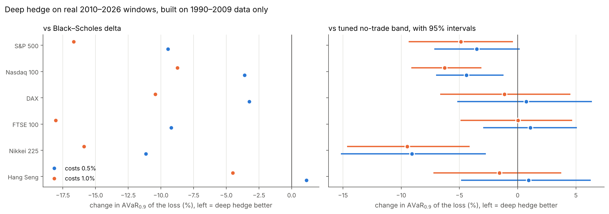
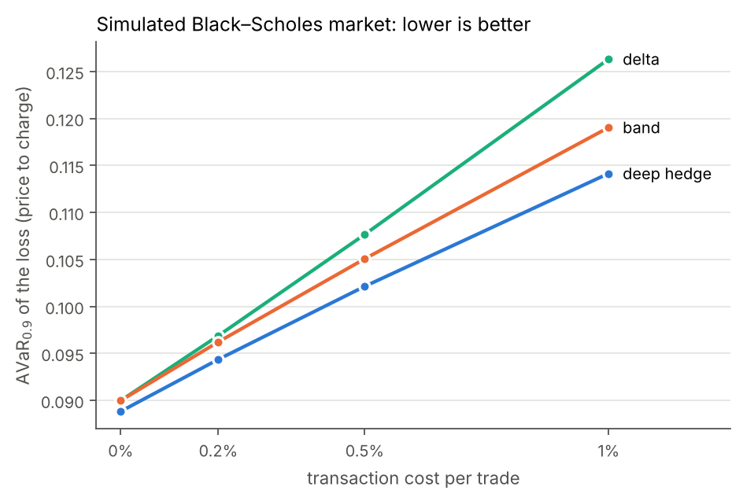
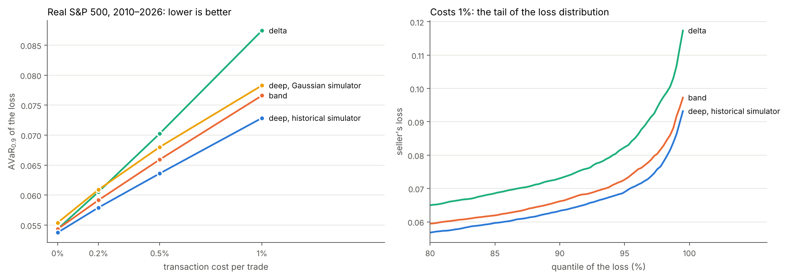
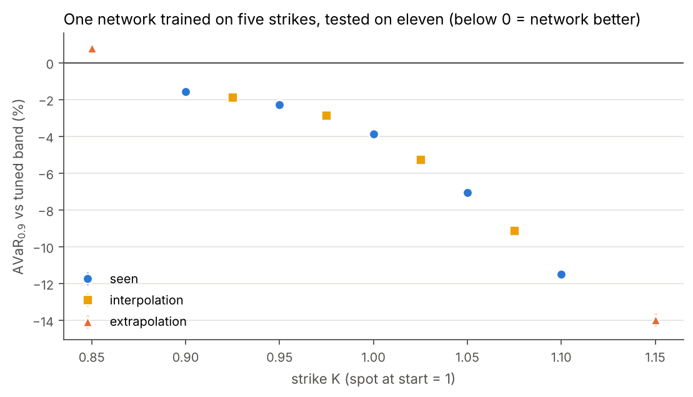

# Deep hedging with transaction costs: from Black–Scholes to real equity markets

Neural hedging policies in the spirit of Buehler et al. (2019), written from scratch in PyTorch and trained to minimise the 90% Average Value-at-Risk of an option seller's loss. The project starts where the answer is known, the Black–Scholes delta, and removes one assumption at a time until the hedge is tested on real prices it never saw.

Built only on 1990–2009 data, the deep hedge lowers the AVaR of a 3-month at-the-money call by **12% on average across six equity indices** compared with Black–Scholes delta hedging (2010–2026 test windows, 1% transaction costs). Against a tuned no-trade band it is better on average (−3.9%), significantly so on three of the six markets, and never significantly worse (95% intervals per market, not adjusted for multiple comparisons).



## Overview

Each part relaxes one assumption of the previous one.

| Part | What changes | Main result |
|---|---|---|
| [1. Black–Scholes](notebooks/01_black_scholes.ipynb) | nothing: frictionless, complete market | the network recovers the delta hedge (P&L standard deviation within 0.2%) |
| [2. Heston](notebooks/02_heston.ipynb) | the market becomes incomplete | the price depends on risk aversion; for a cautious seller the network beats the best delta hedge on all 50 test sets (−0.7% AVaR) |
| [3. Transaction costs](notebooks/03_transaction_costs.ipynb) | every trade costs a fraction of its value | at 1% costs: −9.6% AVaR vs delta, −4.1% vs a tuned Whalley–Wilmott band |
| [4. Real markets](notebooks/04_real_markets.ipynb) | real index prices instead of a simulator | trained on 1990–2009, tested on windows from January 2010 to November 2026: results above |
| [5. Many contracts](notebooks/05_universal_hedge.ipynb) | one network for several strikes, maturities, calls and puts | beats the band on 10 of 11 strikes; level with it on contracts with an unseen strike and maturity |
| [6. Unknown volatility](notebooks/06_volatility.ipynb) | volatility must be estimated and moves | the network falls 0.5% to 2.6% behind a band that uses the same estimate |

## Setup

A seller receives a premium for a European option and hedges it by trading the underlying at $N = 30$ dates. Holding $H_j$ shares on $[t_j, t_{j+1})$ and paying proportional costs $\varepsilon$ on every trade, including the first purchase and the final liquidation, her loss is

$$
X = g(S_T) - \sum_{j=0}^{N-1} H_j\,(S_{t_{j+1}} - S_{t_j}) + \varepsilon \sum_{j=0}^{N} |H_j - H_{j-1}|\, S_{t_j}, \qquad H_{-1} = H_N = 0.
$$

The hedge is a sequence of 30 small networks, one per date. With costs, network $j$ sees the current price and the position it inherits, $H_j = H_{j-1} + f_j(S_{t_j}, H_{j-1}, \dots)$, so it can decide not to trade. All networks are trained jointly to minimise $\mathrm{AVaR}_{0.9}(X)$ in the form of Rockafellar & Uryasev (2000), with the threshold learned alongside the networks. Lower AVaR means a lower price for the same risk.

Every comparison uses two benchmarks: the Black–Scholes delta, and a no-trade band around it (Whalley & Wilmott, 1997) whose width is tuned on the same training or validation data as the network, never on test data.

## Results

**Transaction costs (part 3).** Without costs the network matches delta. With costs it learns to trade less, and the gain grows with the cost level. It does not stop trading: it replaces the large trades of the delta hedge with small adjustments. It beats the band on all 50 independent test sets at every cost level.



**Real markets (part 4).** Trained on Gaussian paths, the network loses to the band on the real S&P 500: the simulator is wrong, and the more flexible policy suffers more from it. Trained on paths built from real 1990–2009 returns (block bootstrap), it becomes the best strategy at every cost level. The gain holds in both halves of the test period and for other seeds, with a 95% block-bootstrap interval of $[-9.4\%, -0.4\%]$ at 1% costs. A GJR-GARCH filtered historical simulation and a recent-volatility input improve it further on the S&P 500 (−6.8% vs the best band) but not consistently across indices.



**One network for many contracts (part 5).** Trained on five strikes, one network beats the band on ten of eleven test strikes, including all interpolated ones. On the tested strikes, at a matched optimisation budget, it achieves comparable AVaR to specialist networks trained on a single strike. On contracts with an unseen strike *and* maturity it is 4% to 9% better than delta and level with a type-specific band (0.8% better on average over three seeds).



## What did not work

- **Training on a wrong simulator.** Trained on Black–Scholes paths, the deep hedge is 1.7% to 3.0% worse than the band on real prices.
- **The 2020 crash.** On the windows that overlap February–April 2020 the network is no better than the band.
- **Three of six markets.** On the DAX, the FTSE 100 and the Hang Seng the difference with the band is within noise; with the volatility input, the Hang Seng is significantly worse at 0.5% costs.
- **Universal vs specialist.** At equal epochs one network for five strikes looks up to 5% better than specialists; at equal optimiser budget the advantage disappears.
- **Extrapolation.** Below the training strikes ($K = 0.85$) the universal network is slightly worse than the band for every seed.
- **Unknown volatility.** Trained across volatility regimes with volatility as an input, the network no longer breaks down when volatility changes, but it does not beat a band given the same (true or estimated) volatility.
- **Input scaling.** Standardising inputs date by date made the multi-contract network fail on an unseen maturity (7–17% worse than the band); fixed scales fixed it.

## Repository layout

```
deephedge/            simulation, Black–Scholes formulas, losses, benchmarks, networks, training
├── simulate.py       Black–Scholes, Heston, multi-contract and stochastic-volatility paths
├── markets.py        real index windows, block bootstrap, GJR-GARCH filtered historical simulation
├── benchmarks.py     delta hedge and no-trade band
├── losses.py         seller's loss with costs, AVaR and its Rockafellar–Uryasev form
├── models.py         one network per trading date
├── train.py          training loop, with optional validation checkpoints
└── stats.py          bootstrap intervals for AVaR comparisons
notebooks/            one notebook per part, executed
scripts/              download_data.py: daily index closes for part 4
results/models/       trained networks of parts 5 and 6
tests/                unit tests
assets/               figures used in this README
```

## Reproducing

```bash
pip install -e .
python scripts/download_data.py      # index data for part 4, saved to data/ (not tracked)
pytest                               # unit tests
jupyter lab notebooks/
```

The notebooks run on CPU, in order; part 6 loads the network trained in part 5. On a 2-core machine they take between 10 and 50 minutes each. Seeds are fixed, and part 4 cuts the data at 2026-11-19, so results do not depend on the download date.

## Context

Parts 1 and 2 started as a course project for *Machine Learning in Finance and Insurance* at ETH Zürich (autumn 2026); parts 3 to 6 extend it.

## References

- H. Buehler, L. Gonon, J. Teichmann, B. Wood (2019). Deep hedging. *Quantitative Finance* 19(8).
- G. Barone-Adesi, K. Giannopoulos, L. Vosper (1999). VaR without correlations for portfolios of derivative securities. *Journal of Futures Markets* 19(5).
- M. Broadie, Ö. Kaya (2006). Exact simulation of stochastic volatility and other affine jump diffusion processes. *Operations Research* 54(2).
- L. Glosten, R. Jagannathan, D. Runkle (1993). On the relation between the expected value and the volatility of the nominal excess return on stocks. *Journal of Finance* 48(5).
- R. T. Rockafellar, S. Uryasev (2000). Optimization of conditional value-at-risk. *Journal of Risk* 2(3).
- A. Whalley, P. Wilmott (1997). An asymptotic analysis of an optimal hedging model for option pricing with transaction costs. *Mathematical Finance* 7(3).

## License

MIT
